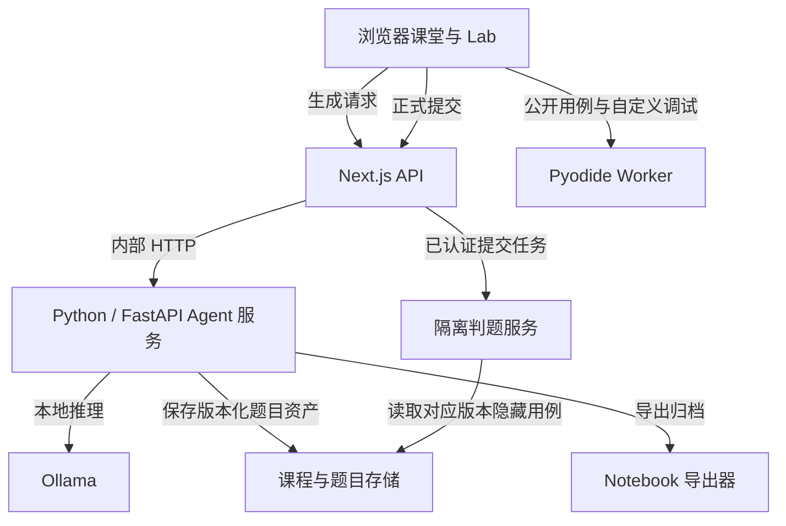

# OpenMAIC-EduPlus：全栈设计架构与落地验收报告（修订版）

- 项目代号：OpenMAIC-EduPlus
- 上游基线：清华大学 OpenMAIC 多智能体课堂底座
- 修订日期：2026-10-15
- 开发目录：`D:\OPENMAIC项目\OpenMAIC\OpenMAIC-main`
- 修订依据：原《OPENMAIC全栈设计方案.md》及本轮对现有代码的架构评审
- 文档性质：目标架构与实施约定。所有“拟采用”“待实现”的能力均不表示已交付。

本报告保留六阶教学流程和双页 Lab 设计，补充服务部署、版本化数据契约、正式评测边界、运行生命周期、生成质量关卡及验收标准。它用于指导后续开发，不替代源码、接口规格或测试报告。

### 2026-10-15 教学与运行质量修正

按用户最新要求，Guided/OJ 从“同一题目的两个模式”调整为“同一考点下的引导题和独立迁移题”，OJ 编辑区不预填代码骨架。公开断言在运行前可见，隐藏用例和参考实现仍只保存在服务端。页面选择的语言进入生成请求并固定为课程语言，所有页面保留原始需求上下文，避免中文界面出现英文讲解或“两数之和”偏成“二维数组求和”。

对于已维护的两数之和课程，原生 PPT 使用固定画布布局和经过审核的算法定义；模拟器使用逐步哈希查找，游戏使用不同下标配对挑战；独立题为统计目标和下标对数量。此题型及其边界用例是维护的教学资产，其他考点仍通过本地模型独立出题并校验，不能将单个题型的浏览器验证泛化为所有模型输出均可靠。

真实首页生成样例 `stage-fZ0VmAnNAGJQ` 已验证中文讲解、模拟器找到 [0,1]、游戏计分、引导题与独立题分别 4/4 公开测试、独立题无代码骨架及中文概念测验。用户故障课程 `stage-0w16rOjxhszq` 已在保留课程地址与所有者的情况下完成原址修复；完整旧文档备份见 `logs/stage-0w16rOjxhszq-before-quality-repair.json`，旧实验资产和草稿保留，不把旧题作答自动移植到新题。正式判题仍未启用。

## 一、项目定位与当前完成度

### 1.1 教学目标

在 OpenMAIC 原生课堂能力上，扩展面向计算机实验课的“讲解—演示—带练—独立编程—检测—复盘”闭环。

原生课堂讲解、对白、模拟器、游戏、测验和总结构成主流程。Python LangGraph 负责新增实验资产生成，通过原生 `generation-runs` 的大纲、内容、动作和文档事务步骤嵌入课堂；它与原生课堂运行调度是两个层次。不得以独立实验入口或数字示例柱状图替代原生互动演示与游戏。

### 1.2 已实现与待实现的边界

以下状态依据本轮评审核对的工程实现。项目更新后，应同步维护本表。

| 模块 | 已实现 | 待完成 |
| --- | --- | --- |
| `ollama_provider.py` | 本地 Ollama 异步通信、JSON/Schema 校验、流式输出、连接与超时重试；API 增加并发名额、总超时和取消管理 | 容量压测与异步生成任务机制 |
| `agent_workflow.py` / `teaching_assets.py` | 四节点 LangGraph；Teacher、Lab 真实调用模型；双页资产、结构化用例和静态检查；公开/私有投影；真实讲解与概念测验生成 | 生成质量执行关卡、题意教学审查 |
| `app/api/generate/route.ts` | 真实 Python 内部服务调用、用户身份解析、请求/响应校验、课程保存、错误响应 | 异步任务及生成幂等机制 |
| `eduplus_courses` / `eduplus_drafts` / `eduplus_practice_events` | 公开/私有同事务快照、所有者隔离、身份领取迁移；分场景草稿及修订冲突；原生课堂映射同事务提交；练习事件幂等保存 | 题目版本更新、多学生独立作答、正式提交存储 |
| `jupyter_exporter.py` / 复盘导出 | 学生模板与保存作答 Notebook；当前内核 pytest 桥接；教师 Notebook 构建及默认关闭的认证角色接口；复盘 Markdown 归档可见对白 | 配置教师认证、对白范围选择与 Notebook 综合归档 |
| `/` 原生入口与 `/classroom` | 原生生成链路内嵌 Guided/OJ Lab，保留讲解、模拟器、游戏和测验；草稿、公开测试、自定义输入调试、复盘与下载；`/eduplus` 仅保留为开发诊断页，已移除首页入口 | 跨学生共享权限、容量与断网冷启动验收 |
| 前端运行错误防护 | Pyodide 模板生命周期修复；场景级 Error Boundary；固定 Lab 组件、本地运行资产、opaque iframe/Worker 隔离、超时终止与旧事件过滤 | 已保存故障课程迁移、浏览器资源容量测试 |
| OJ 判题 | 生成 pytest 资产及静态语法/结构检查；浏览器公开测试仅作练习 | 用户选择正式判题暂不启用；权威判题、隔离执行、资源限制、隐藏用例管理待容器环境就绪 |

当前准确里程碑为：**本机按所有者隔离的演示闭环已跑通：真实生成—原生六阶课堂—双页练习与草稿—Worker 公开测试—概念测验—事实复盘—学生 Notebook / 复盘 Markdown 下载。正式 OJ 判题按用户决定暂缓；教师私有材料默认不开放，多学生共享权限尚未配置。**

2026-10-14 修正：此前独立 `/eduplus` 入口与另建课堂的验证不等于首页原生生成链路融合，原完成判断范围不准确。现已将 Python Lab 接到首页实际使用的原生生成服务，并保持“讲解—模拟器/游戏—Guided Lab—OJ Lab—检测—复盘”顺序。用户已有课程 `stage-Vm7Z_fxadAmw` 在保留原讲解、测验、课程地址及备份的前提下升级为 8 个内容页。新首页生成样例验证了课堂内公开测试 3/3、草稿修订 1 和自定义输入实际返回 27；自定义调试不记为测试成绩。

实际发现并修复的故障包括：Python HTML 编辑器将 CodeMirror npm/ES 模块当普通脚本加载；模型把 simulation/game/code 写为场景类型；已生成页面漏定义 publishState。对应措施为固定 Lab 组件与隔离 Worker、规范场景类型归一化和配置补全、平台提前注入有界状态发布辅助函数。原生 iframe 的维护型 KaTeX 依赖现由本地资源提供，并为透明旧页面提供可读背景；iframe 隔离权限保持不变。

实验课和理论课已通过真实 HTTP 生成、课堂创建与复用、复盘、导出和所有者隔离验证；默认教师导出返回 403。浏览器已验证六阶切换、公开测试 2/2、原生测验 3/3、事实复盘、切场景保留未保存编辑，以及此前的死循环终止、恢复运行、API 网络拦截和刷新草稿恢复。测验通过证明流程可用，不证明模型题目语义无误；课程仍为 `static-validated`，需要教学审核。实施细节见 `EDUPLUS_CLASSROOM_USAGE.md`、`LAB_CONTRACT_V1.md` 与浏览器练习说明。

## 二、整体教学流程与原生课堂融合

本轮验收细节见 `EDUPLUS_ACCEPTANCE_REPORT.md`：相关 101 项 TypeScript 与 68 项 Python 测试、类型检查及生产构建通过。扩大回归中的原框架聊天写入测试仍有失败，其中一项已在未修改基线复现；不将全项目标记为全绿。部署前还需处理动态文件追踪警告与认证配置。

### 2.1 六阶教学闭环

“Scene 1—6”表示教学角色与建议顺序，不是全局固定 ID。实际课程由稳定的 `sceneId` 和明确的 `sceneType` 标识，可以有多张讲解页、多个实验或省略不适用的阶段。

当 `requires_lab=false` 时，应保留适合理论课的教学流程，不强行生成实验或制造空白 Lab 页面。

### 2.2 各阶段职责

| 教学阶段 | 目标与展示 | 关键约束 |
| --- | --- | --- |
| 概念引入 | 标题、目标、知识点、板书与伪代码 | 使用上游画布约定；验证长文本、公式与不同视口，避免简单依赖 Flex 就承诺无溢出 |
| 互动演示 | 原生 JS/Canvas 模拟器、多智能体讲解 | 保留 iframe 隔离；治理加载与 DOM 错误；逐步完成运行资产本地化 |
| 引导编程 | 分步任务、脚手架、公开冒烟测试、伴学提示 | 默认有可编辑代码；运行反馈与正式评分区分 |
| 独立闯关 | 独立迁移题、文字入口规范、公开示例、空白作答区 | 与引导页共享考点，题目 ID、规格和评测各自独立；不预填代码骨架，隐藏用例只在服务端 |
| 随堂检测 | 客观题与知识迁移检查 | 区分概念掌握程度和代码通过情况 |
| 总结复盘 | 学习轨迹、错题与实验归档 | 只引用已保存事实；可见对白 Markdown 已实现，完整归档与范围选择待扩展 |

新增 Lab 的界面与运行框架采用开发者维护的固定组件。模型主要生成题目元数据、教学内容和 Python 资产，避免每次重新生成编辑器、Worker 通信和判题基础设施。

## 三、服务部署与职责划分

### 3.1 推荐调用关系

Python 服务、Ollama 和判题服务可以部署在本机或局域网，服务拆分不意味着必须使用云端模型。

### 3.2 模块职责

- Next.js：请求与运行时响应校验、用户/课程权限、请求关联 ID、响应映射和下载入口。
- Python Agent 服务：LangGraph 调度、LLM 调用、实验规格校验、资产版本化与 Notebook 导出。
- Ollama：本地推理，不承担题目持久化或执行学生代码。
- 浏览器 Worker：运行公开练习与调试，保持主界面可响应。
- 判题服务：在隔离执行环境中运行提交代码，给出正式评测结果。
- 存储层：管理课程、场景、题目版本、草稿、提交记录及私有评测资产。

Next.js 请求处理进程和 Agent 服务进程不直接执行学生提交或未经验证的模型代码。

### 3.3 生成任务生命周期

第一版可采用有总时限的请求—响应接口。需要明确内部连接超时、总生成时限、有限重试及用户取消行为。

当生成时间超过可接受等待范围时，升级为任务机制：提交生成请求返回 `202 + jobId`，通过轮询或 SSE 获取阶段进度，再领取结果。WebSocket 主要用于需要双向交互的课堂会话，不必作为所有生成请求的首期前置条件。

任务状态至少区分 `queued`、`running`、`succeeded`、`degraded`、`failed`、`cancelled`。重复提交及重试应有幂等规则，避免同一需求反复消耗推理资源。

## 四、统一数据契约与版本管理

### 4.1 单一契约来源

以服务端 Pydantic 模型/JSON Schema 作为规范来源，生成或同步前端 TypeScript 类型，并在 API 边界保留运行时校验。TypeScript 类型提示本身不能验证 HTTP 返回数据。

外部 JSON 字段统一采用 camelCase；Python 内部可使用 snake_case，通过明确的别名或适配层转换，禁止依赖前端猜测字段名。

每个对外数据对象携带 `schemaVersion`。题目内容变化形成新的 `problemVersion`；不能用同一题目 ID 静默覆盖隐藏测试。

### 4.2 当前四字段接口的定位

早期四字段响应 `sceneId`、`markdownContent`、`interactiveCode`、`template` 已替换为版本化 `PublicCourse`，前端读取 `scenes`。原生课堂经独立适配层创建 Stage/Scene，不再猜测模板字段或加载模型生成的运行器。

`system.md` 是模型提示词文件。它不应被前端当作可执行 HTML 或渲染器。后续把 `template` 升级为受控模板标识，例如 `guided-lab-v1`、`oj-lab-v1`，或采用明确允许的本地模板路径。禁止按模型返回的任意路径动态加载脚本。

在前端接入前确定新契约；若存在旧调用方，通过显式适配维持四字段接口，并标记其版本和迁移期限。

### 4.3 拟采用的公共 Lab 契约

| 数据组 | 关键字段 | 约定 |
| --- | --- | --- |
| 身份与版本 | `schemaVersion`、`courseId`、`sceneId`、`sceneType`、`problemId`、`problemVersion` | 双页共享课程，各自拥有独立场景、题目身份与版本 |
| 内容 | `markdownContent`、`title`、`difficulty`、`instructions`、`constraints` | 题面明确输入输出及边界 |
| 渲染 | `template`、`language` | 模板与语言来自允许列表 |
| 代码 | `interactiveCode`、`entryPoint` | 入口描述类名、方法名、参数顺序/类型及返回类型 |
| 教学 | `teachingSteps`、`hints` | 引导页提供分步任务；自主页控制提示程度 |
| 公开验证 | `examples`、`publicTestCases` | 可发送到客户端并用于 Diff |
| 执行限制 | `executionPolicy` | 描述超时、输出限制等；正式限制由服务端执行 |
| 生成状态 | `generationStatus`、`warnings` | 明确标识可重试错误或降级内容 |

`sceneType` 至少区分 `guided-lab` 与 `oj-lab`。按 2026-10-15 用户最新要求，两个场景围绕同一考点设计不同任务：引导页提供脚手架，自主页采用不同题目规格和空白作答区，不预填代码骨架。旧共享题目的资产保持可读取。

### 4.4 私有判题契约

隐藏测试、参考实现、内部校验结果和完整评分策略存放在服务端。学生端响应只携带题目版本及必要公开信息。

正式提交请求包含题目身份、版本、语言和学生代码。用户身份由认证上下文确定，服务端校验其课程访问权限，不信任客户端自行填写的用户 ID 或评分结果。

## 五、双页 Lab 详细设计

### 5.1 Guided Lab：引导编程

界面显示分步教学清单、伴学提示、代码编辑器和自定义输入面板。首次进入提供有效脚手架，后续进入优先恢复该学生的代码草稿。

脚手架带标准入口、类型提示和按步骤划分的 TODO。必要的基础数据结构由固定运行库或经审核的题目资产提供，不能缺少类定义。

运行过程执行语法预检、参数验证、公开冒烟测试或独立调试。语法检查用于定位错误，不是安全隔离证明。

保留原始异常类型、行号与学生代码位置；教学翻译器另外给出解释和建议。无法从错误证据确认原因时，不应断言学生犯了特定算法错误。

stdout、stderr、返回值分别收集，并限制输出长度。无法 JSON 序列化的结果返回明确错误。调试输入与正式提交相互独立。

### 5.2 OJ Lab：独立闯关

展示题面、约束、难度、公开示例与标准入口。第一版统一采用 `class Solution` / `solve`，避免引导页用类方法而自主页改成无关函数签名。

自主页从空白编辑区独立作答，不提供类声明、函数签名源码或空方法体；入口规范以题面文字给出。与引导页共享知识点，但题目 ID、输入输出定义、公开用例、隐藏评测与题目版本独立管理。

浏览器练习按钮执行公开用例；正式提交调用服务端评测。两种结果在界面上明确标识为“练习结果”和“正式评测结果”。

### 5.3 参数转换与结果比较

第一版支持整数、字符串、布尔值及受约束的列表参数。树、链表、图放到后续阶段。

复杂类型采用固定适配器注册表。以 TreeNode 为例，需要统一空树、层序数组、空节点、最大节点数和输出序列化规则。模型只能选择允许的类型及规格，不能下发任意反序列化执行代码。

比较器同样来自注册表：有序精确比较、无序集合/多重集比较、浮点容差等。题目必须说明顺序、重复值和精度语义，禁止依靠简单字符串比较覆盖所有结果类型。

### 5.4 Diff 与隐藏信息保护

- 公开用例失败：展示输入、预期值、实际值、异常或差异位置。
- 隐藏用例失败：展示失败类别、允许公开的覆盖信息和教学提示，不默认展示完整输入和答案。
- 正式结果：区分 Accepted、Wrong Answer、Syntax Error、Runtime Error、Time Limit Exceeded、Memory Limit Exceeded 和评测基础设施错误。

用例执行采用有界队列或顺序执行，不无限并行占用浏览器或服务器资源。首个失败即停止与运行全部用例的策略应在协议中明确。

耗时描述为本次运行测量值。浏览器测量受设备和缓存影响，不用于跨学生性能排名。

## 六、可信评测与生成质量关卡

### 6.1 两级评测边界

| 路径 | 运行位置 | 用例 | 可信度与用途 |
| --- | --- | --- | --- |
| 本地练习 | Pyodide Worker | 公开测试、学生自定义输入 | 学习反馈；可离线；不作为防篡改的正式评分依据 |
| 正式评测 | 服务端隔离运行器 | 固定版本公开/隐藏测试 | 正式提交记录与评分依据 |

Worker 分离 UI 线程，但仍可能使用网络、存储及其他浏览器能力。它本身不是严格安全沙箱。断网部署也不会自动消除全部运行风险。

正式运行器独立于 Next.js 和 Agent 进程，配置执行时间、内存、进程、输出及临时磁盘上限，默认禁止网络访问并使用最小文件权限。优先采用经验证的 Linux 隔离环境；Windows 本地开发可通过 WSL2/容器接入。具体隔离技术、限制和支持语言必须通过测试验收。

### 6.2 Eval 的两层职责

当前 Eval 主要完成输出格式检查。目标架构增加确定性的执行验证，不以另一个模型的主观评价替代测试。

发布实验前至少检查：

1. JSON Schema、题面、入口、模板、参考实现和用例字段一致。
2. 代码语法正确，学生与参考实现入口签名一致。
3. 参考实现通过所有候选测试。
4. 未实现的学生模板不能通过评测。
5. 候选输入符合题面范围，边界用例与约束相符。
6. 参数转换、返回值序列化及比较器行为经过验证。
7. 校验本身在有资源限制的执行环境中进行。

参考实现与用例可能共同生成错误。重要题型进一步采用已知题库、独立小规模 oracle、性质测试或教师审核。未经质量关卡的题目不得成为正式评分任务。

### 6.3 题目冻结

通过验证后冻结题目版本，记录来源、模型标识、提示词/生成规则版本、测试集标识和质量结果。正式提交始终引用对应版本，避免生成修复后改变既有评分标准。

## 七、运行生命周期与状态隔离

### 7.1 生命周期状态

运行状态至少区分 `idle`、`loading`、`ready`、`running`、`failed`、`disposed`。加载失败显示局部提示并允许受控重试，不让页面静默停留在加载中。

React 渲染异常由场景级 Error Boundary 处理。Promise、事件处理器和 Worker 的异步错误需要各自捕获并传递给界面，不能仅依赖 Error Boundary。

生成 HTML 中必要 DOM 元素缺失时，返回可定位的错误并显示 fallback；可选装饰元素可以跳过。每次异步加载完成后重新检查页面生命周期和必要元素，避免使用被移除的节点。

### 7.2 消息关联与迟到响应

每条运行消息携带 `sceneId`、`problemVersion`、`executionId` 和 `runtimeEpoch`。主线程仅接受当前活动运行的响应。

切题、取消、超时或重建运行器时更新 epoch，并将旧请求完成为 cancelled/timeout，避免遗留 Promise 一直等待。

### 7.3 复位策略

每次执行创建新的 Python globals 命名空间，并处理测试缓存、标准流、临时文件和返回值代理资源。清空 globals 不等于清空导入模块和整个解释器状态；需要强隔离时重建 Worker/运行器。

主线程维护总执行超时。当 Worker 无法处理消息，例如学生代码进入无限循环时，直接 `terminate()` 并重建，不能依赖 `RESET_SCOPE` 消息救援。

`RESET_SCOPE` 可以作为合作式空闲复位协议，但需要确认响应。运行中不能声称仅发出该消息就已完成复位。

### 7.4 草稿与活动运行分离

学生草稿按用户、课程、题目版本和场景类型保存。切换页面取消活动执行、更新终端显示和运行上下文，但保留该题草稿；回到场景恢复草稿，而不是重新覆盖为初始模板。

这与上游 iframe keep-alive 机制兼容：保留学习状态，同时通过运行身份和作用域隔离消除跨题污染。

## 八、防错准则修订

### 8.1 运行时资产本地化

将原“零外部依赖”调整为“运行时资产本地化与版本锁定”。允许使用成熟依赖，但运行时所需资产必须可在目标部署中获得。

资产清单包含：Pyodide JS/WASM、Python 包及依赖、Monaco 和其 Worker、字体、KaTeX、CSS、模拟器脚本等。限制运行中任意安装包或访问外部源。

验收同时覆盖新浏览器/清空缓存的断网启动和缓存后的热启动。记录加载时长与资源大小，再确定冷启动、热启动目标；“秒级加载”是待测指标，不是未经验证的保证。

### 8.2 必要元素校验与局部恢复

保留 DOM 就绪、ref 和销毁清理规则；补充单次初始化、异步完成复查、Worker 错误捕获与场景级 fallback。

必要节点缺失必须报告，不统一采用静默 `if (!element) return`。该策略会掩盖 ID 不一致，并让用户得到没有解释的空白页。

### 8.3 严格输出校验与有标识的降级

生成过程采用“严格 JSON/Schema 校验 → 有限修复重试 → 明确失败或明确标记的降级”。

仅对确定的外层 Markdown 包裹做受控处理，不使用简单正则从任意混合内容中猜测嵌套 JSON。模型 JSON 模式不能替代字段、源码和语义检查。

移除原文“解析失败绝不返回 500、始终返回成功骨架”的约定。错误响应是正常协议：前端应展示错误状态和重试按钮。候选错误分类包括无效请求、模型服务不可用、超时、上游格式失败和内部错误；具体 HTTP 状态在接口规范中固定。

如果返回默认骨架，必须标注 `generationStatus=degraded`，说明未完成内容生成，并禁止正式评分。不能把降级或 Mock 输出伪装成完整课程。

### 8.4 可观测性

通过 requestId/jobId/executionId 关联 API、Agent 和评测日志。记录阶段耗时、失败类型及修复次数；不默认记录完整学生代码、提示词、隐藏测试或参考答案。日志和私有资产访问需要权限约束。

## 九、Notebook 导出与课堂归档

### 9.1 当前导出能力

`jupyter_exporter.py` 已导出三个单元格：教学 Markdown、学生代码、评测代码。评测通过临时文件让 pytest 收集测试，并桥接 Notebook 当前内核中的学生实现。

单元格隐藏 metadata 是展示设置，下载文件的人可以读取源码。因此学生 Notebook 中的评测代码必须被视为公开练习测试，不能包含正式隐藏用例。

Notebook 当前保留教学、代码与评测单元格。另有复盘 Markdown 导出已保存的学生/Agent 可见文字（最多最近 200 条），遵守原生记录删除与恢复标记，不包含系统提示、推理与工具信息。将对白合入 Notebook 的综合归档、范围选择及双向同步属于后续功能。

### 9.2 目标导出版本

- 学生版：题面、目标、知识点、学生代码、公开测试、允许归档的学习对白及问题版本。
- 教师版：经授权另外包含参考答案、完整评测材料、教学记录和必要质量信息。

导出接口进行用户与课程权限校验，使用受控文件位置或流式下载，不接受未经约束的客户端任意磁盘路径。课堂对白导出应提供范围选择，并区分教师内部提示与可公开会话内容。

归档记录课程、题目、运行资产/依赖版本及导出时间。保存的执行输出注明来源；默认不自动执行模型或学生源码来完成导出。

## 十、三阶段实施路线与验收门槛

### 阶段一：补齐后端规格与服务化（B 主导）

1. 冻结公共/私有题目模型、入口与比较器规则。
2. 将单份 LabSpec 升级为双页资产，使用同一考点下的引导题与独立迁移题，分别管理题目版本。
3. 提供 Python Agent 服务接口，Next.js 替换 Mock。
4. 接入生成质量关卡、持久化和错误分类。
5. 完成基础类型题目的正式评测运行器。

验收：真实 HTTP 生成链路可运行；非法 JSON/字段、模型停机、超时和验证失败均有明确结果；参考实现通过、占位模板失败；公共响应不泄露私有资产。

### 阶段二：接口冻结与前后端联调（B/C 协同）

1. 发布 schemaVersion、公共 DTO、错误契约和运行消息协议。
2. 联调固定示例资产，再联调真实模型生成。
3. 验证身份/课程权限、题目版本与提交记录。
4. 长任务需要时补充进度、取消和任务结果接口。

验收：Guided/OJ 共享课程与考点，题目身份各自独立，OJ 无代码骨架；Guided 展示至少四项公开断言；前端无需猜测字段或加载 system.md；错误与降级可见；取消和迟到消息处理正确。

### 阶段三：前端实验室与运行环境落地（全栈主导）

1. 固定 Lab 编辑器和教学/题面组件。
2. 部署本地 Pyodide、编辑器 Worker 及其他资产。
3. 实现公开练习、自定义 IO、正式提交及分级 Diff。
4. 实现草稿保存、运行器复位、超时终止和局部恢复。
5. 对接原生课堂与学生/教师导出入口。

验收：断网且无缓存条件下完成公开练习；无限循环可恢复；大量输出被截断；切题后迟到结果不覆盖新页面；返回题目草稿不丢失；原生课堂流程保持可用。

### 首版范围

优先支持 Python、基础 JSON 参数、固定 Solution.solve 入口、Guided/OJ 双页、公开练习及基础正式评测。暂缓树/图等复杂适配器、跨语言执行、完整对白归档和跨设备性能排名。

暂缓能力在文档和界面中明确标识，不用占位实现表示已经支持。

## 十一、必须纳入的验收用例

| 类别 | 核心用例 | 预期 |
| --- | --- | --- |
| 生成 | 非 JSON、缺字段、源码围栏、错误入口 | 校验或修复；不发布错误题目 |
| 服务 | Ollama 停机、慢加载、重复请求、取消 | 有界等待、有限重试、明确错误/任务状态 |
| 质量 | 错误参考实现、总是通过的测试、非法边界 | 阻止正式题目发布 |
| 隔离 | 无限循环、大量打印、超限资源、禁止网络 | 终止/限流；主界面和服务仍可响应 |
| 状态 | 运行中切题、迟到消息、反复运行、回到旧题 | 正确关联、无跨题污染、草稿恢复 |
| DOM | 节点缺失、加载期间移除、页面销毁、CDN/资产失败 | 局部错误提示、无未处理初始化拒绝 |
| 保密 | 检查学生 API、Worker 消息和 Notebook | 正式隐藏用例及参考答案未被下发 |
| 离线 | 清缓存后断网、包资源缺失、字体/Worker 缺失 | 可定位失败；目标练习功能按资产清单运行 |
| 导出 | 中文文本、三个单元格、当前内核重跑、权限 | 标准 Notebook；公开评测可运行；导出权限正确 |

## 十二、修订决策摘要

| 原方案表述 | 修订后约定 |
| --- | --- |
| 后端已全部完成 | 真实服务、双页协议、持久化、原生课堂与复盘已验证；正式判题、执行质量关卡、共享授权和容量验收未完成 |
| 单套浏览器盲盒判题 | 公开本地练习与服务端正式评测分层 |
| 错误用例全部展示完整 Diff | 公开用例完整展示；隐藏用例控制反馈范围 |
| RESET_SCOPE 保证物理清空 | 新执行上下文、有确认的复位、超时终止与必要的运行器重建 |
| 切场景清空编辑器 | 保存按题目版本隔离的草稿，清理活动执行 |
| 解析失败永远返回成功骨架 | 有限修复、明确错误或可识别的降级，禁止假成功评分 |
| JSON/AST 检查代表实验可靠 | 增加隔离执行质量关卡和独立正确性核查 |
| 零外部依赖、无网必然秒开 | 运行资产本地化、版本锁定、冷/热启动实测 |
| system.md 用作前端模板 | 提示词与前端受控渲染模板标识分离 |
| 已支持含对白流的 Notebook | 学生/教师 Notebook 分离及可见对白 Markdown 已实现；对白尚未合入 Notebook，教师下载默认关闭 |

## 2026-10-15 补充：情境自主编程与标准输入输出

本机单用户演示使用框架内置 `OWNER_SINGLE_USER=true` 和固定 `local` 所有者，开发服务只绑定 `127.0.0.1`。原生课堂、实验资产、草稿和复盘必须在同一身份下读取，不能只验证公开讲解页面。旧匿名课堂的迁入须先备份，并保持课堂及实验所有者一致；不得以删除接口所有权校验解决 404。

- 课堂保持讲解、模拟器/游戏、引导编程、自主编程、随堂检测、复盘的顺序。引导题与自主题使用不同任务规格和题目 ID；自主编程不提供代码骨架。
- 新自主题采用标准输入输出完整程序。界面明确展示两个框：输入、输出/错误；用户输入数据并点击运行，支持 `input()`、`sys.stdin` 和 `print()`。语法错误、运行异常和可核对的错误答案都在输出框展示。
- 自主题难度中等偏下，强调具体场景和综合应用：数组配对主题对应露营采购预算组合，树主题对应三种巡检顺序，背包主题对应救援物资装包。维护题型的任意合法自定义输入由可信练习算法核对；未知题型只核对公开样例，不能将“程序没有异常”等同于答案正确。
- 公开契约增加可选 `executionMode` 和 `standardIoProfile`，旧课程默认函数模式。参考实现及隐藏用例继续只存服务端；浏览器运行不构成正式判题。正式容器判题按用户决定暂不启用。
- “两数加和算法”作为数组 Two Sum 的常见别名纳入识别；明确的标量 `a+b` 课程保持单独语义。讲解页使用有界的原生 PPT 布局，代码示例保留缩进换行；模拟器和游戏使用维护的交互实现并校验输入，避免模型脚本产生空页面或 NaN。

## 十三、技术参考

- [Pyodide：在 Web Worker 中运行及独立执行上下文](https://pyodide.org/en/stable/usage/webworker.html)
- [MDN：Worker 能力、消息通信及网络访问](https://developer.mozilla.org/en-US/docs/Web/API/Web_Workers_API/Using_web_workers)
- [MDN：Worker.terminate()](https://developer.mozilla.org/en-US/docs/Web/API/Worker/terminate)
- [React：Error Boundary](https://react.dev/reference/react/Component#catching-rendering-errors-with-an-error-boundary)
- [pytest：调用方式和重复调用的导入缓存](https://docs.pytest.org/en/stable/how-to/usage.html)
- [nbformat：Notebook 读写与结构验证](https://nbformat.readthedocs.io/en/latest/api.html)

依赖版本及 Worker 加载方式以实际部署锁定版本为准。上线前重新核对对应版本文档，并将测试结果与本报告的目标架构分别归档。
