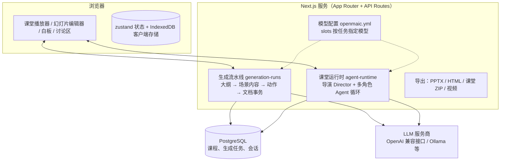
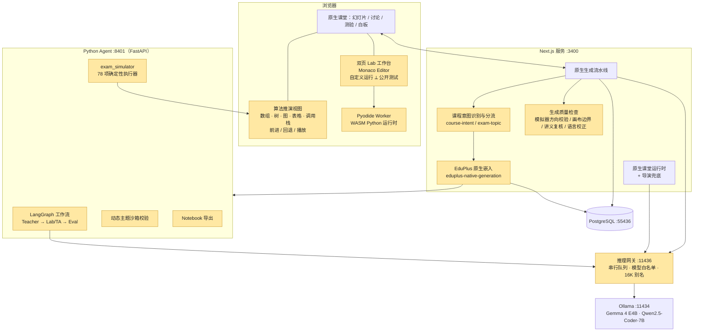
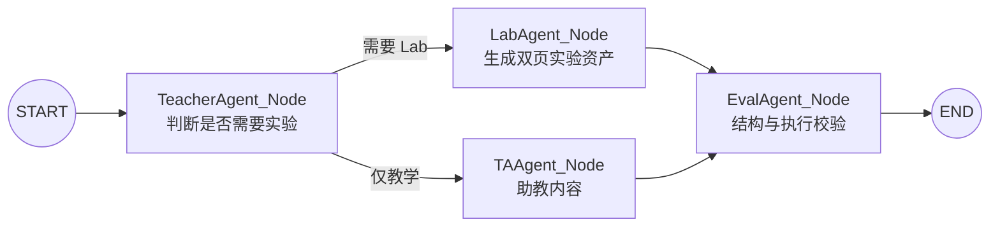
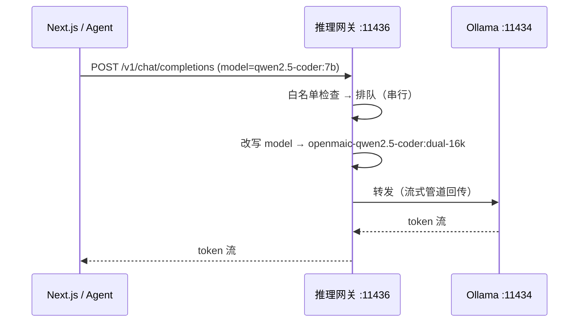

# 基于OpenMAIC的离线AI算法课堂 · 项目总结与复盘

> 2026 第八届全球校园人工智能算法精英大赛 · 算法主题赛 AI+开源
>
> 团队：啊对对队 ｜ 参赛编号：AIC-2026-13718360 ｜ 方向：开源项目改进与生态贡献
>
> 整理日期：2026-10-30 ｜ 对应版本：项目源码包 SHA256 `d2ff1aba4a695e4f79d5378fe703c8b72e67d6ff8539cbb4b5de72b388b5fbb6`

---

## 目录

1. [项目概况](#一项目概况)
2. [整体架构：原生与二次开发](#二整体架构原生与二次开发)
3. [底层架构详解](#三底层架构详解)
4. [二次开发涉及的开发知识点](#四二次开发涉及的开发知识点)
5. [开发过程复盘](#五开发过程复盘)
6. [经验与教训](#六经验与教训)
7. [遗留问题与后续方向](#七遗留问题与后续方向)
8. [附录：速查表](#附录速查表)

---

## 一、项目概况

### 1.1 要解决的问题

算法学习的难点在于三件事的衔接：**抽象规则**（定义、条件、复杂度）、**执行过程**（每一步的状态变化）和**代码实现**（输入约定、边界、输出）。现有工具往往各管一段，而且依赖云端大模型，在网络受限的环境里用不了。

### 1.2 我们做了什么

以清华 THU-MAIC 开源的多智能体课堂框架 **OpenMAIC 1.2.0-rc.2（MIT）** 为底座，在不改变原生课堂的前提下，为算法和编程主题接入三项能力：

| 能力 | 一句话说明 |
|---|---|
| 可执行的算法推演 | 78 项预置算法由确定性执行器算出状态轨迹；目录外的主题由模型生成候选程序，在 WASM 沙箱里运行校验后才使用 |
| 两级编程实验 | 引导编程（模板 + 分步提示）与自主编程（空白作答）；自定义输入调试与公开测试分开反馈 |
| 完全本地化运行 | Gemma 4 E4B + Qwen2.5-Coder-7B 双模型经 Ollama 本地推理，数据库、浏览器运行资源全部本地准备，断网可用 |

**核心设计原则：模型只负责“说”，程序负责“算”。** 推演状态、参考答案和练习评测都来自实际运行的程序，不来自模型推断。

### 1.3 最终交付物

| 交付物 | 说明 |
|---|---|
| 技术报告（PDF，23 页） | 按官方模板排版，含开源及第三方资源使用清单附录 |
| 演示视频（MP4，3 分 45 秒） | 含片头片尾、字幕，断网环境录制 |
| 项目源码包（zip，57.3MB，5476 个文件） | 二次开发源码、执行器、测试、部署脚本、交付说明（依赖核对索引、253 份第三方许可、运行环境版本记录）、演示视频 |
| 报名平台材料 | 作品名称（19 字）、作品简介（284 字）、百度网盘成果链接 |

### 1.4 时间线

| 时间（2026） | 阶段 | 主要内容 |
|---|---|---|
| 10-12 前后 | 起步 | 拉取上游 OpenMAIC，建立团队开发目录，本地跑通 Ollama 单模型 |
| 10-14 ～ 10-15 | 设计定型 | 《全栈设计方案（修订版）》：六阶教学闭环、双页 Lab、数据契约、两级评测边界；EduPlus Lab 接入原生生成链路 |
| 10-17 ～ 10-20 | 算法课攻坚 | Dijkstra、Kruskal、Prim、Floyd、KMP、LCS 等课堂逐个修复；严格判题模式；模拟器审计 |
| 10-23 | 逻辑检查 | 以上游提交 `d725f191` 为基线逐模块审查：课程意图识别、理论课分流、Lab 页规格、测验出题规范 |
| 10-24 | 边界与离线 | 明确“普通主题保持原生”的二次开发边界；离线部署脚本（setup / start / check）；上下文截断问题定位 |
| 10-25 | 双模型主开发版 | 独立主开发目录；Gemma + Qwen 双模型、16K 运行别名、串行推理网关；三轮修复（讨论零回复、PPT 排版、模拟器、语言） |
| 10-26 | 用户反馈修复 | 公共流程验收、第二轮用户反馈修复与实测记录 |
| 10-28 ～ 10-29 | 交付 | 技术报告定稿与图表重绘、源码包打包与核验、演示视频字幕与片头片尾、报名平台提交 |

---

## 二、整体架构：原生与二次开发

### 2.1 原生 OpenMAIC 架构（1.2.0-rc.2）

OpenMAIC 是一个“一键生成课堂”的多智能体教学平台。1.2.0 起改为**服务端优先**：课程生成在服务端运行（关页面不中断），模型在 `openmaic.yml` 中统一配置，课程持久化到 PostgreSQL。



**原生能力清单（我们保留并复用的部分）：**

| 模块 | 原生能力 | 关键目录 |
|---|---|---|
| 课程生成 | 主题/资料 → 大纲 → 场景（幻灯片、测验、交互页、PBL）→ 讲解动作；阶段检查点、可恢复 | `lib/server/generation/run`、`lib/server/generation/steps` |
| 场景类型 | 可编辑幻灯片、测验、HTML 交互模拟、项目制学习（PBL）、深度交互（3D/模拟/游戏/思维导图） | `components/scene-renderers`、`components/slide-renderer` |
| 多智能体课堂 | AI 教师、助教、学生角色；导演协调发言顺序；圆桌讨论；自由问答；白板实时绘制 | `lib/agent-runtime`、`lib/orchestration`、`components/roundtable`、`components/whiteboard` |
| 编辑 | 幻灯片元素直接编辑、“Edit with AI”、可编辑大纲 | `lib/edit`、`components/edit` |
| 导出 | 可编辑 PPTX、交互 HTML、课堂 ZIP、讲稿 Word/Markdown、MP4（需渲染服务） | `lib/export`、`lib/video-export` |
| 模型配置 | `openmaic.yml` 的 providers / slots / lock，按任务槽位绑定模型，可禁止用户自带密钥 | `lib/server/model-config` |
| 持久化 | PostgreSQL 服务端持久化；旧版浏览器数据自动迁移 | `lib/persistence`、`lib/server/classroom-persistence.ts` |
| 安全 | SSRF 防护、重定向校验、访问码、实例密钥检查 | `lib/server/ssrf-guard.ts` 等 |

### 2.2 二次开发后的架构

黄色为团队新增或改造的模块。



### 2.3 原生与二次开发的边界

二次开发的总原则（2026-10-24 确定）：**只作用于算法、数据结构和编程课堂；普通主题（如牛顿定律、光合作用）按原生 OpenMAIC 生成与展示，只做不改变设计的缺陷修复。**

| 层次 | 原生 OpenMAIC（保留） | 团队新增 / 改造 |
|---|---|---|
| 课程入口 | 主题、资料、角色配置、课程语言 | 课程意图识别：算法 / 编程 / 纯理论 / 普通主题分流；“Lab agent”可选角色 |
| 大纲 | 模型自主规划场景 | 算法课按“讲解 → 模拟器 → 游戏 → 引导编程 → 自主编程 → 测验 → 总结”排序；普通主题不强制编程页 |
| 幻灯片 | 可编辑元素、原生提示词 | 画布边界检查与重叠分离（`canvas-bounds.ts`）、字号下限、Markdown 强调修正、无效媒体清理 |
| 讲解台词 | 模型生成 | 台词依据真实控件与真实运行帧生成；混杂语言校正 |
| 交互模拟 | 模型生成 HTML 页 | 算法课：确定性执行器驱动的推演视图；普通课：先规划设计再渲染，学科方向校验 + 数值求导核对，滑块必须引起可见变化 |
| 讨论 | 导演 + 多角色 Agent 循环 | 导演一轮无人发言时由教师兜底回答；上下文压缩按本地模型真实窗口计算 |
| 测验 | 模型出题 | 独立复核（不看作者答案的解题者）、单/多选答案数一致性、确定性算法测验快照 |
| 编程实践 | 原生“在线编程”交互页 | 双页 Lab（引导 / 自主）、Pyodide Worker 执行、标准输入输出、参考输出比对、草稿、Notebook 导出 |
| 模型接入 | `openmaic.yml` 槽位、OpenAI 兼容接口 | 双模型分工、推理网关、Modelfile 16K 运行别名 |
| 持久化 | PostgreSQL 课程与生成任务 | EduPlus 课程 / 草稿 / 练习事件表，所有者隔离 |
| 部署 | Docker / 手动部署，需联网 | 离线部署脚本、运行资源本地化（Pyodide / Monaco / KaTeX）、离线自检、源码包打包工具 |

### 2.4 双模型任务分工

| 模型 | 承担任务（`openmaic.yml` 槽位） | 选型理由 |
|---|---|---|
| Gemma 4 E4B（dual-16k 别名） | `course.content.slide` 课件正文、`course.actions` 讲解动作、AI 教师实时回答 | 端侧效率高，文本组织与多语言表现好 |
| Qwen2.5-Coder-7B | `course.outline` 大纲、`course.content.quiz` 测验、`course.content.interactive` 互动页、`classroom` 讨论调度、`agent`、Python Lab 资产、课件正文独立复核 | 代码生成、推理与修复能力强，指令遵循好 |

---

## 三、底层架构详解

### 3.1 进程与端口拓扑

| 进程 | 端口 | 技术 | 职责 |
|---|---|---|---|
| Web 服务 | 3400 | Next.js 16.3.3（生产构建） | 页面、API、生成流水线、课堂运行时 |
| Python Agent | 8401 | FastAPI + Uvicorn | LangGraph 工作流、算法执行器、Notebook 导出 |
| 推理网关 | 11436 | Node.js `http` 原生实现 | 串行排队、模型白名单、请求改写 |
| Ollama | 11434 | Ollama 0.40.11 | 本地模型推理 |
| PostgreSQL | 55436 | PostgreSQL 15.19 | 服务端持久化（库名 `openmaic_dual_main`） |

运行与开发模式共用同一套端口，二选一启动；两个模型共享同一张显卡，所以推理必须串行。

### 3.2 前端层

| 技术 | 版本 | 在项目中的作用 |
|---|---|---|
| Next.js（App Router） | 16.3.3 | 页面路由（`app/`）与 API 路由（`app/api/`）同仓 |
| React | 19.2.3 | 组件化 UI；场景级 Error Boundary 防止单页崩溃拖垮课堂 |
| zustand + immer | 5.x / 11.x | 课堂状态管理，不可变更新 |
| Dexie（IndexedDB） | 4.x | 浏览器端部分客户端状态与旧版数据迁移 |
| Monaco Editor | — | Lab 代码编辑；改用 textarea 输入模式以兼容课堂快捷键 |
| Pyodide（WASM） | 0.29.3 | 浏览器内运行 Python；放在 Web Worker 中，与 UI 线程隔离 |
| KaTeX / ECharts / Tailwind CSS | 0.16 / 6.1 / 4 | 公式渲染、图表、样式 |
| Vercel AI SDK（`ai`、`@ai-sdk/openai`） | 6.x / 3.x | 统一的模型调用与流式输出 |
| zod | 4.x | API 边界的运行时校验 |

**浏览器执行的关键设计：**
- 每次执行新建 Python 全局命名空间；每个用例新建隔离运行环境。
- 主线程维护总超时，Worker 卡死（死循环）时直接 `terminate()` 重建，不依赖“复位消息”自救。
- 每条运行消息携带 `sceneId`、`problemVersion`、`executionId`、`runtimeEpoch`，切题后迟到的结果被丢弃，不会覆盖新页面。
- 草稿按“用户 × 课程 × 题目版本 × 场景类型”保存，切页取消活动执行但保留草稿。

### 3.3 服务端层（Next.js）

**生成流水线**（`lib/server/generation/run`）：`plan → runner → engine`，分阶段执行“大纲 → 场景内容 → 动作 → 文档事务”，每阶段写检查点，支持截止时间（`deadline.ts`）、有限重试（`retry.ts`）、SSE 进度推送（`sse.ts`）和失败码归类（`failure-code.ts`）。

**团队在流水线上挂接的步骤与检查**（`lib/server/generation/steps` 及相关文件）：

| 文件 | 作用 |
|---|---|
| `eduplus-native-generation.ts` | 把 Lab 资产嵌入原生生成链路；按课程意图决定插入哪些页 |
| `lib/eduplus/course-intent.ts`、`exam-topic.ts` | 课程意图与算法主题识别（与 Python 端共用 `exam-topic-routing.json`） |
| `widget-reliability.ts`、`widget-fallback.ts`、`widget-smoke-worker.cjs` | 模拟器先设计后渲染；运行时冒烟检查（画布空白、拖动不重绘即判缺陷） |
| `simulation-check.ts` | 模拟器公式的学科方向校验：独立模型调用给出定性方向，再对公式数值求导比对 |
| `lib/edit/canvas-bounds.ts` | 幻灯片画布越界、文字与底框重叠的自动修复 |
| `speech-language.ts`、`lecture-language.ts`、`course-translation.ts` | 混杂语言校正与课程语言跟随 |
| `quiz-review.ts`、`algorithm-quiz.ts` | 测验独立复核；确定性算法测验 |
| `local-context-window.ts` | 按本地模型真实上下文窗口压缩讨论历史 |

### 3.4 Python Agent 层



- **FastAPI 接口**：`/health`、`/v1/generate`（公开课程 `PublicCourse`）、`/internal/v1/generate`、`/internal/v1/simulations/trace`（算法轨迹）、`/internal/v1/notebook`、`/internal/v1/teaching` 等；内部接口校验认证头。
- **Pydantic 数据契约**：服务端模型为规范来源，对外字段 camelCase、内部 snake_case，通过别名转换；每个对象带 `schemaVersion`，题目变化形成新 `problemVersion`。
- **公开 / 私有投影**：参考实现与隐藏用例只存服务端，学生端只收到公开信息。
- **代码指纹**：Agent 上报代码指纹，与网页端不一致时自动重启，避免改了代码还在跑旧进程。

### 3.5 算法执行层（exam_simulator）

```python
REGISTRY = {}

def algorithm(key, title, aliases, default, section):
    def register(fn):
        if key in REGISTRY:
            raise RuntimeError('Duplicate simulator id')
        REGISTRY[key] = dict(id=key, title=title, aliases=aliases,
                             default=default, section=section, run=fn)
        return fn
    return register
```

- **注册表模式**：每个算法用装饰器注册，统一维护 ID、名称、别名、默认输入、所属章节和执行函数。共 78 项，按模块分布在 `foundations / sequences / trees / graphs / multiway / advanced / dynamic / generated` 等文件。
- **数据驱动的轨迹**：执行器只产出不可变的状态快照（`seq` 序列、`grid` 矩阵等视图类型，含指针、高亮、依赖关系），不执行模型代码、不 `eval`、不执行学生代码。
- **输入约束**：`ints()` 等校验函数限制长度和取值范围，非法输入明确报错。
- **多语言**：`i18n.py` + `locale_en.json`，728 条模板覆盖全部 78 个算法；先执行、校验，再按课程语言渲染文字，数据不变。
- **前后端识别一致**：Python 端导出 `exam-topic-routing.json`，前端 `exam-topic.ts` 读取同一份规则，33 条自然说法逐条对照测试。

**目录外主题的动态路径**：模型生成候选程序 + 输入输出说明 + 验证样例 → 核对算法身份与输入域 → 在 WASM 沙箱中运行候选程序与校验程序（Worker 隔离、指令预算、时限、资源上限）→ 有差异则把反例交回模型局部修复 → 通过后连同源码摘要、输入约定和验证信息保存。

### 3.6 推理层：网关与上下文



- **为什么需要网关**：两个模型共用一张 8GB 显卡，并发请求会互相挤占显存；网关把请求串行排队，切换模型时由 Ollama 负责卸载与加载（`keep_alive` 5 分钟）。
- **上下文截断问题**：Ollama 的 OpenAI 兼容接口（`/v1`）**不能按请求设置 `num_ctx`**，默认窗口只有 4096。课堂导演的长提示被静默截断，结果是“讨论零回复”。
- **解法**：用 Modelfile 为两个模型各建一个 16384 上下文的运行别名（`FROM qwen2.5-coder:7b` + `PARAMETER num_ctx 16384`），由 `prepare-dual-model.ps1` 自动创建；网关把 `/v1` 请求改写到别名，原生 `/api` 请求则直接在 `options.num_ctx` 里注入。
- **安全**：网关只接受白名单内的两个模型名，不记录提示词。

### 3.7 持久化与数据

| 数据 | 存储位置 |
|---|---|
| 课程、场景、生成任务、会话（原生） | PostgreSQL |
| EduPlus 课程快照、草稿、练习事件（新增） | PostgreSQL（`eduplus_courses` / `eduplus_drafts` / `eduplus_practice_events`），所有者隔离，同事务提交 |
| 部分客户端状态、旧版课程 | 浏览器 IndexedDB |
| 本机凭据 | `.env.local`、`database-runtime.json`（由准备脚本在本机生成，**不随包分发**） |
| 运行资源 | Pyodide、Monaco、KaTeX 等由 `prepare-eduplus-assets.mjs` 按固定完整性校验下载到本地 |

---

## 四、二次开发涉及的开发知识点

### 4.1 前端工程

- **Next.js App Router**：页面与 API 同仓、服务端组件与客户端组件的边界、生产构建与开发模式（`pnpm dev` 会清掉生产构建，启动脚本需检测并自动重建）。
- **React 19**：Error Boundary 只捕获渲染错误；Promise、事件处理、Worker 的异步错误要各自捕获并传到界面。
- **Web Worker + WASM**：Pyodide 在 Worker 中运行；`postMessage` 通信协议设计；`terminate()` 是唯一可靠的死循环终止手段；消息关联 ID 与 epoch 防止迟到响应。
- **Monaco Editor**：新版用 EditContext 输入（不是 textarea），会让外层快捷键误判“用户没在打字”，需切回 textarea 模式并给编辑区打 `data-native-keyboard` 标记。
- **iframe 隔离**：模型生成的交互页放在 opaque iframe 中运行，平台提前注入有界状态发布函数。
- **画布排版算法**：文本框溢出时先扩展、再下移同栏后续元素、最后缩字号（有下限）；背景卡片与文字的层级、包含关系判定。

### 4.2 服务端与接口

- **长任务设计**：分阶段检查点、截止时间、有限重试（只重试可恢复错误）、SSE 推送进度、失败码分类。
- **契约优先**：Pydantic / JSON Schema 作为单一规范来源，TypeScript 类型不能代替运行时校验（zod 校验 HTTP 边界）。
- **版本化数据**：`schemaVersion`、`problemVersion`；题目冻结后正式提交引用固定版本。
- **公开 / 私有分离**：隐藏用例和参考实现只在服务端；Notebook 里的评测代码视为公开内容。
- **所有者隔离**：本机单用户使用 `OWNER_SINGLE_USER=true` 与固定 `local` 所有者，不能靠删除所有权校验解决 404。
- **进程管理**：Agent 代码指纹与自动重启；按需自启（`EDUPLUS_AGENT_AUTO_START`）。

### 4.3 大模型工程

- **按任务分配模型**：用 `openmaic.yml` 的槽位把大纲、课件、动作、测验、讨论绑定到不同模型。
- **上下文窗口管理**：OpenAI 兼容接口与原生接口的参数差异；Modelfile 派生别名；按真实窗口压缩对话历史。
- **结构化输出与修复**：严格 JSON / Schema 校验 → 有限修复重试 → 明确失败或带标记的降级，禁止把降级内容伪装成完整结果。
- **生成后校验**：
  - 独立复核：用“看不到答案”的第二次调用解题，比对一致性；
  - 学科方向校验：让模型只凭知识回答“输入增大时量怎么变”，再对公式数值求导核对；
  - 运行时冒烟：渲染后检查画布是否空白、拖动是否重绘。
- **多语言一致性**：课程语言指令贯穿页面、台词、平台控件；识别中文中夹杂的英文并校正；翻译时数字、标识符、代码原样保留。
- **模型分工的边界**：模型只返回教学内容和生成文件，状态与计算结果一律由执行器给出。

### 4.4 算法与执行安全

- **确定性执行器**：注册表模式、不可变状态快照、输入范围校验、视图类型（序列 / 矩阵 / 树 / 图 / 调用栈）。
- **沙箱执行**：WASM（Pyodide）+ Worker 隔离 + 指令预算 + 时限 + 输出长度限制；浏览器 Worker 不是严格安全沙箱，只用于练习反馈。
- **两级评测边界**：浏览器公开练习（学习反馈）与服务端正式评测（防篡改评分）分层；本项目按决定暂未启用正式判题。
- **参考输出比对**：自定义输入时，参考解在 WASM 沙箱中算出参考输出，页面比对显示 ✓ / ✗；未知题型只核对公开样例，“程序没报错”不等于“答案正确”。
- **生成质量关卡**：参考实现必须通过全部候选测试，未实现的模板必须不能通过。

### 4.5 测试与质量

- **多层测试**：Python `pytest`（执行器、名称识别 150 项等）、前端 `vitest`、组件渲染测试、`tsc --noEmit` 类型检查、Playwright 端到端与渲染确认。
- **基线对比法**：在修改前的上游提交上跑同一套测试，确认失败集合完全一致，才能说“无新增失败”。
- **矩阵测试**：课堂模式分流 14 个场景、前后端识别一致性 33 条说法。
- **执行结果核对**：用独立程序或人工推算核对推演与评测结果（如二叉树四种遍历）。
- **环境差异**：Python 3.13 的 `tokenize` 行为变化导致 4 项测试在云端失败、本机 3.11 通过——测试结论要注明运行环境。

### 4.6 部署与运维

- **离线化三件套**：联网准备一次（`准备运行环境.cmd`：依赖、数据库、模型、构建）→ 断网自检（`离线自检.cmd`）→ 启动（`启动平台.cmd`）。
- **运行资源本地化**：从“零外部依赖”改为“运行时资产本地化 + 版本锁定 + 完整性校验”。
- **PowerShell 与 cmd 脚本**：`chcp 65001` 处理中文输出；CRLF 换行；缺少 `.env.local` 时给出明确提示而不是报错退出。
- **数据库隔离**：独立端口和库名，与旧版、测试版互不影响；一致性备份导入；密码与令牌独立生成。
- **版本回退**：旧版单模型完整备份保留独立数据库与启动入口。

### 4.7 开源合规与交付

- **许可证义务**：MIT（上游，保留版权声明）、MPL-2.0（Pyodide，提供源码获取说明）、LGPL-3.0-or-later（mathml2omml，满足库替换要求）、Apache-2.0（模型）、OFL-1.1（字体）。
- **依赖核对**：前端直接依赖 167 项、Python 安装依赖 83 项的核对索引；253 份 LICENSE / NOTICE 随包提供。
- **打包安全**：排除 `.env*`、本地数据库、`recovery`、日志、`node_modules`、`.venv`、`.next`；打包时扫描密钥与身份信息；校验值与打包报告写在包外。
- **可复现交付**：SHA256 写进技术报告，评委可核对；任何重新打包都必须同步更新报告。

---

## 五、开发过程复盘

### 5.1 关键问题与根因

| # | 现象 | 根因 | 解决方式 | 启示 |
|---|---|---|---|---|
| 1 | 课堂讨论零回复、提示“数据流中断” | Ollama `/v1` 接口不能按请求设 `num_ctx`，默认 4096 截断导演长提示；导演首轮返回 END/未知名字时整轮结束 | Modelfile 16K 别名 + 网关改写；导演无效时教师兜底；错误提示改为“智能体无响应” | 本地模型的“静默截断”最难查，先确认实际上下文窗口 |
| 2 | 普通主题（牛顿定律、万有引力）出现做题式游戏、算法式模拟器 | 为算法课设计的规则写成了对所有主题生效；勾选 Lab agent 后算法处理波及普通课 | 明确二次开发边界：普通主题保持原生，Lab 只追加编程相关页 | 二次开发要先划边界，再写规则 |
| 3 | “纯理论讲解快速排序”仍生成编程实验 | 意图识别漏判否定表达；Python 端用整段平台提示词做判断（提示词本身含关键词） | 扩充否定词规则；只对原始教学需求判断；前后端共用一套识别规则 | 规则判断要限定输入范围，两端规则要单一来源 |
| 4 | 模拟器公式物理方向错误（如加速度写成 G·m2/(m1·r²)）、光合效率 265% | 模型对学科常识不可靠 | 学科方向校验 + 数值求导；高频主题使用固定模拟器 | 生成内容需要“独立于生成过程”的检验 |
| 5 | PPT 文字溢出、底框错位、字号过小 | 模型布局不考虑实际渲染高度 | 画布边界检查、重叠分离、字号下限、提示词约束 | 版面问题用确定性后处理，不只靠提示词 |
| 6 | 英文课堂中 Lab 页仍是中文 | Lab 题面由中文管线生成，页标题写死 | 生成阶段翻译 + 打开时按语言返回显示副本；评测资产不翻译 | 显示文本与评测数据分开，翻译只动前者 |
| 7 | 编程页无法输入字母 m、空格触发播放 | Monaco 新输入模式与课堂快捷键冲突 | 编辑区按键交给输入；切回 textarea 模式 | 组件库升级会改变底层输入机制 |
| 8 | 解压源码包后直接启动报错 | `.env.local` 按安全要求不随包分发，启动脚本未做缺失检查 | 打包时注入守卫：缺配置时提示先运行“准备运行环境” | 安全排除与易用性要一起设计 |
| 9 | 技术报告 PDF 行尾标点消失（7 处） | LibreOffice 中文行尾标点悬挂，被页边距裁掉 | 经 ODT 将标点换行方式改为 simple 后再导出 PDF；逐处比对 docx 与 PDF 文本 | 导出 PDF 后要做文本级比对，不能只看页数 |
| 10 | 平台简介计数 310 > 300 | 从 PDF 复制会在中英文交界处加空格 | 简介缩到 284 字（含空格最多 295）；从 txt 复制 | 平台计数规则要实测 |

### 5.2 做得好的地方

- **“模型说、程序算”的原则贯彻始终**：推演、参考答案、评测结果全部来自实际执行，评委关注的“结果可信”有据可查。
- **复用而不是重写**：课程生成、多角色讨论、导出、持久化全部沿用原生，团队精力集中在算法和实验这一块。
- **每次修复都补回归测试**，并用基线对比证明“无新增失败”。
- **版本隔离到位**：旧版备份、测试版、主开发版各有独立目录、端口和数据库，随时可回退。
- **交付材料可核验**：源码包 SHA256、依赖索引、许可文件、运行环境版本记录一应俱全，报告数字都能在包里找到出处。
- **安全底线清楚**：本机凭据、私有数据库、日志从不外发；不通过删除校验、伪造 Accepted 来“修好” bug。

### 5.3 可以做得更好的地方

- **边界定得晚**：“普通主题保持原生”到 10-24 才明确，之前为算法课写的规则已经波及普通课堂，返工了两轮。
- **本地模型的约束了解得晚**：4096 上下文截断的问题在多处表现为不同症状（讨论无回复、生成不完整），花了较长时间才定位到同一个根因。
- **缺少固定的计时基准**：完整生成耗时没有按固定主题测量，报告里只能写定性结论。
- **组件渲染测试依赖本机**：云端环境缺依赖，部分 `.tsx` 测试只能在本机跑，验证周期变长。
- **交付阶段的反复**：作品名、AI 工具披露、简介字数、网盘平台、报告字体等在最后两天多次调整；如果提前读透官方提交表单和格式要求，可以少走弯路。
- **已知缺陷仍在演示中可见**：讨论气泡偶尔显示原始 JSON 文本，演示视频未能完全规避。

---

## 六、经验与教训

1. **先定边界，再写规则。** 二次开发要先回答“哪些场景用新逻辑、哪些保持原样”，并在代码里有显式的分流判断（如 `isAlgorithmCourse`）。
2. **规则只有一个来源。** 前后端都要用的识别规则，由一端导出、另一端读取，并用对照测试锁住。
3. **生成内容必须被独立检验。** 检验手段要独立于生成过程：执行器、独立复核、数值验证、渲染冒烟，而不是让同一个模型“自查”。
4. **本地小模型的工程约束比能力更关键。** 上下文窗口、显存、串行、接口参数差异，决定了能不能稳定跑起来。
5. **降级要可见。** 失败时给出明确状态和重试入口，降级内容要有标记，绝不伪装成功。
6. **数据与显示分离。** 评测资产保持原始数据，翻译、排版、润色只作用于显示层。
7. **交付物要能被别人核验。** 校验值、版本记录、依赖索引、许可文件，让“我们说的”都能被“包里的”证明。
8. **最后一公里同样要测试。** PDF 导出、平台字数计数、网盘链接、文件元数据（作者名）——这些都在交付前一天出过问题。

---

## 七、遗留问题与后续方向

### 7.1 已知遗留问题

- 讨论区偶发显示原始 JSON 文本（演示视频约 1:20–1:46 可见）。
- 普通主题测验仍可能有语义错误；未收录算法的生成成功率依赖本地 7B 模型。
- 正式判题（服务端隔离运行器）按决定暂缓，当前浏览器评测仅作练习反馈。
- 编程实验只支持 Python；Java、C++ 等课程的实验仍为 Python。
- 离线时浏览器语音输入不可用（依赖厂商在线服务）。
- 完整生成耗时缺少按固定配置的计时数据。

### 7.2 后续方向

| 方向 | 本版基础 | 下一步 |
|---|---|---|
| 主题与算法 | 78 项预置 + 目录外动态生成 | 按教学任务补充元数据、执行器与示例测试 |
| 编程语言 | Python 运行器 + 结构化输入输出契约 | 增加新语言执行适配与对应测试 |
| 正式评测 | 两级评测边界已设计 | 容器化隔离运行器、隐藏用例管理、题目冻结 |
| 推理策略 | 双模型按职责分工 | 按固定任务测量质量与阶段耗时，再调整路由 |
| 开源回馈 | 源码包整体交付 | 拆成可独立复用的组件、补丁和教程，尝试向上游提交 |

---

## 附录：速查表

### A. 常用入口（源码包内名称）

| 文件 | 作用 |
|---|---|
| `准备运行环境.cmd` | 联网准备一次：依赖、数据库、模型、构建 |
| `准备本地模型.cmd` | 创建 dual-16k 运行别名 |
| `离线自检.cmd` | 只读检查依赖、资源、数据库、模型 |
| `启动平台.cmd` / `启动平台-开发模式.cmd` | 生产 / 开发模式启动，访问 http://127.0.0.1:3400 |
| `停止平台.cmd` | 停止网页、Agent 与队列 |
| `生成离线分发包.cmd` | 生成离线分发包 |

### B. 关键文件索引

| 领域 | 文件 |
|---|---|
| 模型路由 | `openmaic.yml`、`scripts/dual-model-gateway.mjs`、`scripts/prepare-dual-model.ps1` |
| 意图与分流 | `lib/eduplus/course-intent.ts`、`lib/eduplus/exam-topic.ts`、`lib/eduplus/exam-topic-routing.json` |
| 原生嵌入 | `lib/server/eduplus-native-generation.ts`、`lib/eduplus/native-outline.ts`、`lib/eduplus/classroom-adapter.ts` |
| 算法执行 | `exam_simulator/*.py`、`exam_simulator/i18n.py`、`scripts/dynamic-trace-sandbox.mjs` |
| Agent | `agent_api.py`、`agent_workflow.py`、`ollama_provider.py`、`teaching_assets.py`、`jupyter_exporter.py` |
| Lab 实践 | `lib/eduplus/practice-runner.ts`、`lib/eduplus/stdio-oracle.ts`、`lib/server/eduplus-reference-output.ts` |
| 生成质量 | `lib/server/generation/simulation-check.ts`、`lib/server/generation/steps/widget-reliability.ts`、`lib/edit/canvas-bounds.ts` |
| 打包 | `scripts/offline/build_submission.py`（开发目录内，不随包分发） |

### C. 运行环境版本（交付时记录）

Node.js 24.21.0 ｜ pnpm 10.28.0 ｜ Python 3.11.5 ｜ PostgreSQL 15.19 ｜ Ollama 0.40.11 ｜ Next.js 16.3.3 ｜ React 19.2.3 ｜ TypeScript 5.9.3 ｜ Pyodide 0.29.3 ｜ FastAPI 0.143.0 ｜ Pydantic 2.14.1 ｜ LangGraph 1.2.14

### D. 相关文档

- `OPENMAIC全栈设计方案_修订版.md`：目标架构与实施约定
- `主开发版本说明.md`、`离线部署说明.md`：目录、入口、端口与部署步骤
- `OPENMAIC_逻辑检查与修复记录_2026-10-23.md`、`OPENMAIC_双模型主开发版修复记录_2026-10-25.md`：修复过程
- `用户反馈修复与实测记录-20261026.md`、`最新修复版回归测试报告-20261025.md`：测试数据
- 《基于OpenMAIC的离线AI算法课堂-技术报告》：参赛技术报告
